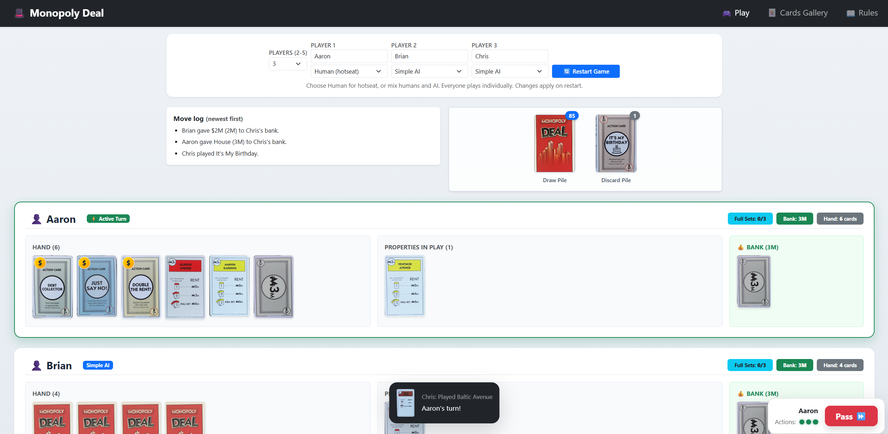

# Monopoly Deal



## Development server

Run `ng serve` for a dev server. Navigate to `http://localhost:4200/`. The application will automatically reload if you change any of the source files.

### Cards API

Run the API from the inner `monopoly-deal` directory, where `server.js` and `package.json` live:

```powershell
npx nodemon server.js
```

MongoDB must also be running at `mongodb://localhost:27017/monopoly-deal`. If using the included Docker setup, start just the database with `docker compose up -d mongo-db` from the same directory. The Cards gallery requests `http://localhost:3000/api/cards`; opening that URL should return a JSON array. Gameplay uses the bundled `src/assets/cards.json`, so it can work even when the API is stopped.

### Responding to AI actions

AI turns pause whenever a human must respond. For Birthday, rent, and Debt Collector, choose an asset from the payment panel. Payments come from your bank, properties, or buildings in play, never your hand. If you have Just Say No, first choose whether to play it or accept the action; accepting then opens the payment chooser. Players with no payable assets owe nothing and are skipped. Human players also choose whether to block property theft or swaps with Just Say No.

### Simple AI preferences

The AI keeps Pass Go, Debt Collector, Birthday, Just Say No, and Deal Breaker for their effects instead of banking them. It prefers completing property sets, assigns wildcards to useful colors, targets opponents who can pay, and avoids collection actions when everyone is broke. Double The Rent is saved until a matching rent card and another action are available. When paying, it prefers bank cards, minimizes overpayment within each asset category, and tries to preserve completed sets. Just Say No protects properties and blocks large payments or payments that would require sacrificing assets beyond the bank. Equal choices are still random; decisions use only the AI's own hand and public board information.

## Docker DB setup

```
docker exec -it monopoly-deal-mongo-db mongosh
use monopoly-deal
db.Cards.deleteMany({})

docker exec -it monopoly-deal-mongo-db mongosh --eval "use monopoly-deal; use Cards; db.Cards.deleteMany({});"


docker cp ./cards.json monopoly-deal-mongo-db:/cards.json
docker exec -it monopoly-deal-mongo-db mongoimport --db monopoly-deal --collection Cards --mode upsert --upsertFields make --jsonArray --file cards.json
docker exec -it monopoly-deal-mongo-db rm -rf cards.json
```
